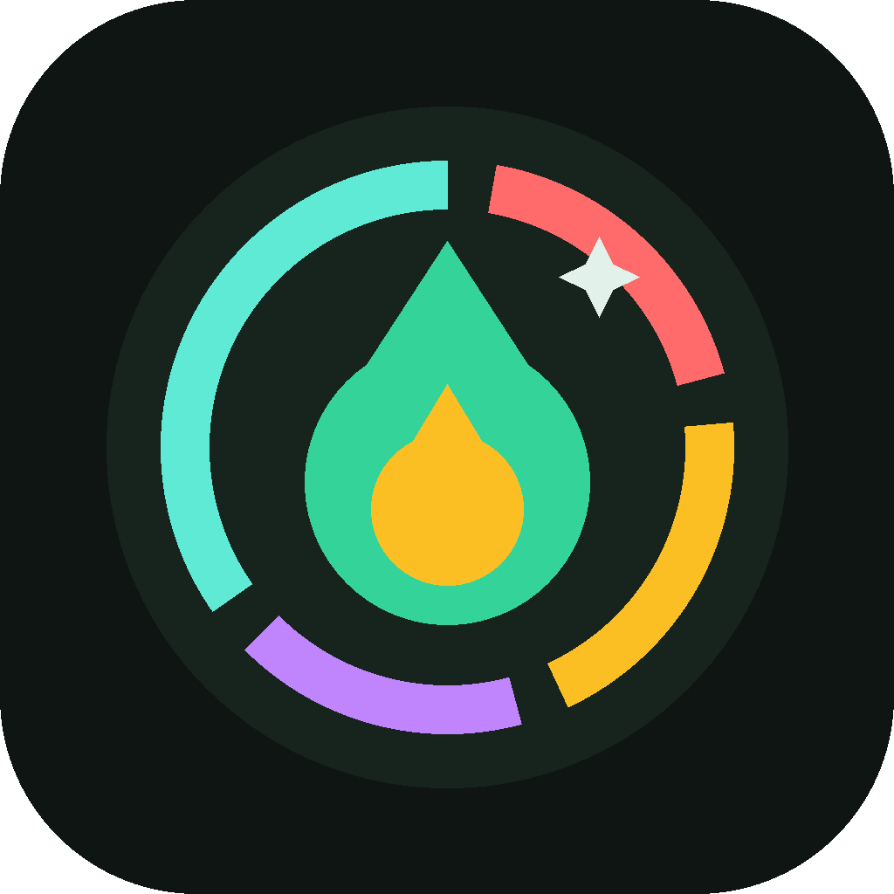
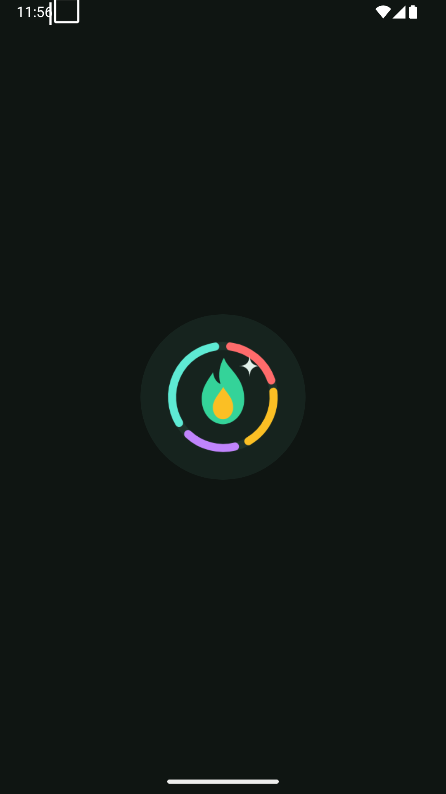
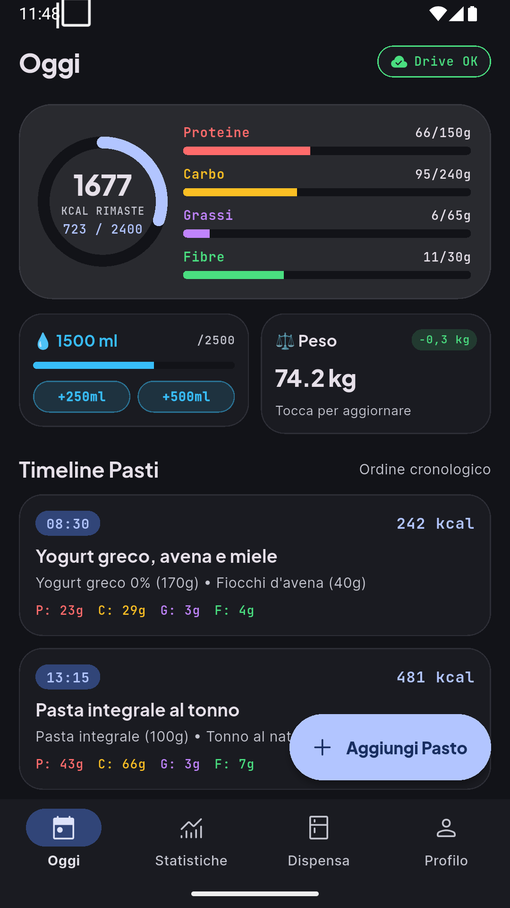
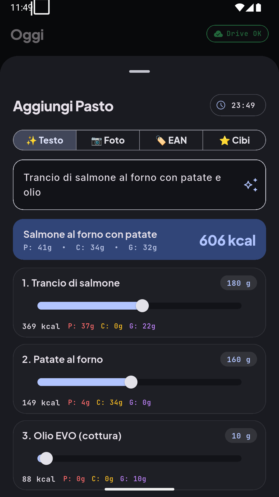
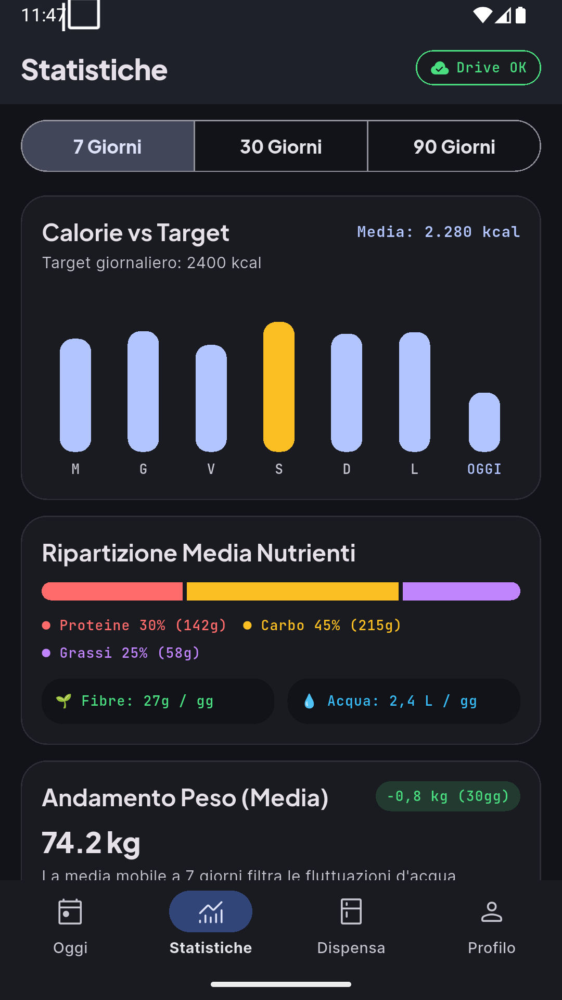
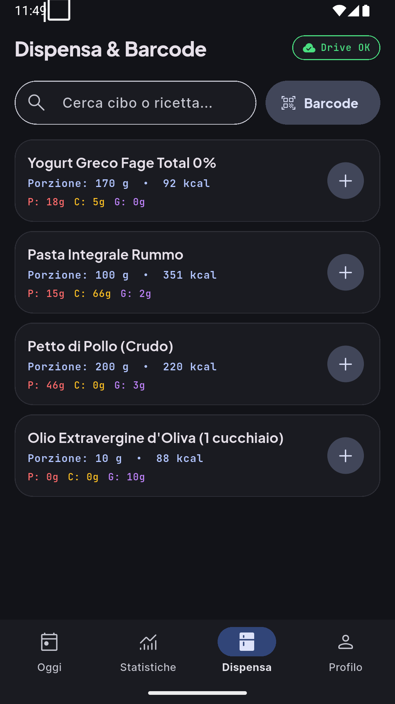
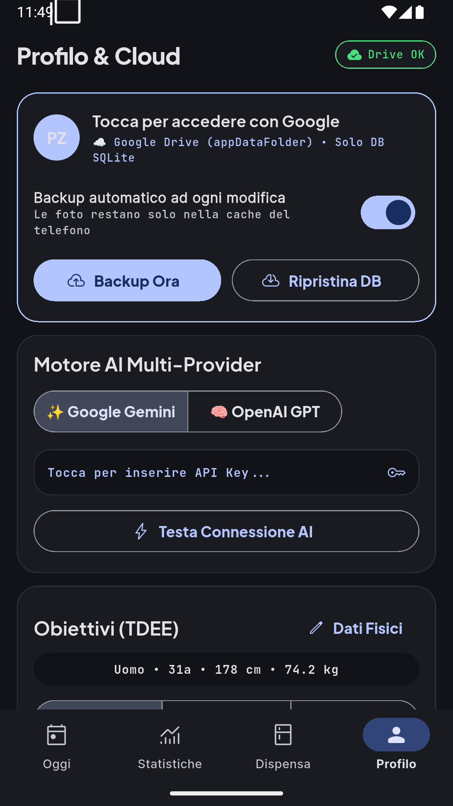

<p align="center">
  
</p>

<h1 align="center">Calorie Tracker AI</h1>

<p align="center">
  <strong>App Android personale in Flutter (Material 3 Expressive) per il tracciamento di Calorie, Macronutrienti, Fibre, Acqua e Peso corporeo con AI Multi-Provider, Barcode Scanner e Backup automatico a costo zero su Google Drive.</strong>
</p>

---

## ✨ Caratteristiche Principali

- **🎨 Material Design 3 Expressive + Material You (`dynamic_color`)**:
  - Superfici tonali dinamiche adattate allo sfondo di Android 12–15 + **5 colori semantici fissi** per riconoscere a colpo d'occhio *Proteine* (`#FF6B6B`), *Carboidrati* (`#FBBF24`), *Grassi* (`#C084FC`), *Fibre* (`#4ADE80`) e *Acqua* (`#38BDF8`).
  - Tipografia a 3 livelli: `Plus Jakarta Sans` (Display/Kcal), `Inter` (UI/Ingredienti) e `JetBrains Mono` con cifre tabulari (`tabularFigures`) per ricalcoli fluidi a 120fps.
- **🤖 Motore AI Multi-Provider (*Google Gemini* + *OpenAI*)**:
  - Analisi dei pasti da **testo/dettatura vocale** o **foto del piatto/etichetta**.
  - Scomposizione negli ingredienti con valori `per_100g` e **slider dei grammi in tempo reale**.
  - Barra conversazionale **"💬 Correggi con AI"** per affinare gli ingredienti prima di salvare.
  - Chiavi API custodite cifrate nell'**Android Keystore** tramite `flutter_secure_storage`.
- **🏷️ Scanner Codici a Barre (OpenFoodFacts)**:
  - Scansione EAN-13 / EAN-8 tramite `mobile_scanner` e interrogazione gratuita delle API pubbliche di *OpenFoodFacts*.
- **💾 Architettura Offline-First a Costo Zero (0 €/mese)**:
  - Database **SQLite locale (`sqflite`)** sul dispositivo per apertura istantanea e funzionamento 100% offline.
  - **Google Sign-In + Auto-Backup su Google Drive (`appDataFolder`)**: sincronizza automaticamente (con debounce di 10s) il solo file `.sqlite` nella cartella nascosta dell'app su Google Drive, lasciando le foto dei piatti nella cache locale del telefono per non consumare spazio cloud.

---

## 📱 Screenshot dell'App (Android 15)

| Splash Screen | Oggi (Dashboard & Timeline) | Aggiungi Pasto (Slider AI) |
| :---: | :---: | :---: |
|  |  |  |

| Statistiche & Diario | Dispensa & Barcode | Profilo, Cloud & TDEE |
| :---: | :---: | :---: |
|  |  |  |

---

## 📚 Documentazione del Progetto

- **[GUIDA_PROGETTO.md](GUIDA_PROGETTO.md)**: Architettura tecnica, schema SQLite delle 5 tabelle e contratto JSON dell'AI.
- **[DESIGN_SYSTEM.md](DESIGN_SYSTEM.md)**: Specifiche complete del Design System Material 3 Expressive.
- **[design_system_preview.html](design_system_preview.html)**: Showcase HTML5 interattivo apribile nel browser per testare palette, font e componenti.
- **[GOOGLE_CLOUD_SETUP.md](GOOGLE_CLOUD_SETUP.md)**: Guida passo-passo per configurare Google Drive API (`appDataFolder`), OAuth SHA-1 e API Key gratuita di Google Gemini.

---

## 🚀 Avvio Rapido

```bash
# 1. Installa le dipendenze Flutter
flutter pub get

# 2. Avvia l'emulatore Android configurato e lancia l'app
./run_emulator.sh

# Oppure compila direttamente l'APK
flutter build apk --debug
```
